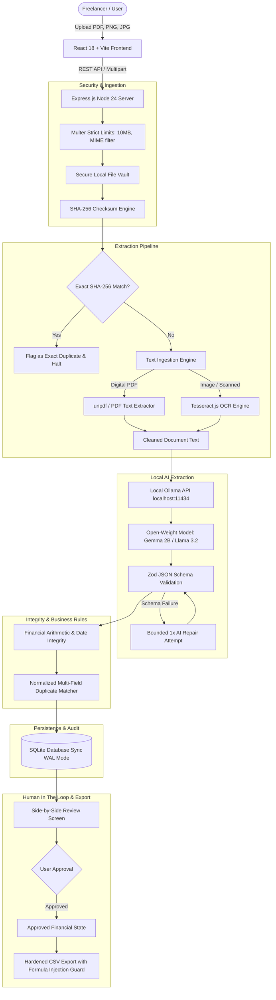

# InvoicePilot — Local-First AI Invoice & Receipt Assistant

[](#hacktoberfest-2026-submission-write-up)
[](#ai-invoice-extraction)
[](#security--local-privacy-guarantees)
[](LICENSE)

**InvoicePilot** is a production-minded, local-first artificial intelligence invoice and receipt management system built for freelancers, independent contractors, consultants, and small business owners.

Unlike cloud-based accounting SaaS platforms that transmit sensitive financial records, vendor contracts, client identities, and line-item prices to third-party APIs (such as OpenAI, Claude, or Google Cloud), InvoicePilot runs the entire extraction, optical character recognition (OCR), duplicate detection, and financial math validation pipeline **100% on your local machine**.

---

## Architecture Diagram



---

## Key Features

1. **Multi-Format Local Ingestion**: Drag-and-drop support for digital PDFs, scanned documents, PNG, and JPEG receipts with strict 10 MB per-file limits and extension verification.
2. **Hybrid OCR & Digital PDF Parsing**: Automatically reads digital text layers using modern `unpdf`, falling back to `Tesseract.js` for scanned documents and receipt images.
3. **Local-First Open-Weight AI Inference**: Interfaces directly with Ollama on `localhost:11434` (supporting Gemma 2B, Gemma 4, Llama 3.2, or Qwen) with structured JSON enforcement and prompt boundaries.
4. **Resilient Bounded Repair**: If the model output fails JSON parsing or Zod schema validation, a bounded repair prompt is issued once. If the second attempt fails, the record is flagged for human review without crashing.
5. **Deterministic Financial Math Integrity**: Stored in integer minor units (cents) to avoid floating-point math bugs. Cross-checks `Subtotal + Tax - Discount = Total` and alerts the user of arithmetic discrepancies.
6. **Two-Tier Duplicate Detection**:
   - **Exact Duplicate Detection**: Immediate SHA-256 hash match against previously stored documents.
   - **Probable Duplicate Detection**: Matches normalized vendor names, invoice numbers, currencies, and total amounts across existing records.
7. **Side-by-Side Document Reviewer**: Embedded in-browser viewer (PDF iframe / zoomed image preview) alongside editable fields, extracted text evidence, line items, and audit flags.
8. **Interactive Analytics Dashboard**: Interactive Recharts visualizations showcasing monthly spending trajectories, expense category allocation, and top payees with strict multi-currency isolation.
9. **Hardened CSV Export**: Generates RFC 4180-compliant CSV files with UTF-8 BOM encoding for Microsoft Excel and automatic sanitization against CSV Formula Injection (`=`, `+`, `-`, `@`, `\t`, `\r`).
10. **Zero Cloud Dependencies**: The system operates completely offline without internet connectivity during inference.

---

## Technology Stack

### Frontend
- **Framework**: React 18 with TypeScript and Vite
- **Styling**: Tailwind CSS with custom dark mode financial design system
- **Routing**: React Router v6
- **Data Visualization**: Recharts (ResponsiveContainer, BarChart, PieChart, Tooltips)
- **Icons**: Lucide React
- **HTTP Client**: Axios

### Backend
- **Runtime**: Node.js v24 (Native ESM, Built-in SQLite Sync Engine)
- **Framework**: Express.js
- **Validation**: Zod
- **File Uploads**: Multer with strict MIME and batch guards
- **Database**: SQLite with Write-Ahead Logging (`WAL`), strict Foreign Keys, and ACID Transactions
- **Text Extraction**: `unpdf` (Modern PDF.js wrapper) & `Tesseract.js` (OCR)
- **Security**: Node `crypto` (SHA-256), path traversal guards, CSV formula injection sanitization

### Local AI Inference
- **Inference Server**: Ollama (`http://localhost:11434`)
- **Active Model**: `gemma:2b` (Default) or `gemma4:e2b-it-qat` / `llama3.2`

---

## Prerequisites

1. **Node.js**: Version 20.x, 22.x, or 24.x (Verified on Node v24.13.0)
2. **npm**: Version 10+
3. **Ollama**: Installed and running locally ([Download Ollama](https://ollama.com/))
   - Ensure Ollama has pulled at least one open-weight model:
     ```bash
     ollama pull gemma:2b
     # Or for larger GPU setups:
     ollama pull gemma4:e2b-it-qat
     ```

---

## Installation & Setup

### 1. Clone & Enter Repository
```bash
git clone https://github.com/your-username/invoicepilot.git
cd invoicepilot
```

### 2. Configure Environment Variables
Copy `.env.example` to `server/.env`:
```bash
cp .env.example server/.env
```

Default configuration in `server/.env`:
```env
PORT=3001
HOST=localhost
NODE_ENV=development

# Storage paths
DATA_DIR=./data
UPLOAD_DIR=./data/uploads
DB_PATH=./data/invoicepilot.db

# Upload Limits
MAX_FILE_SIZE_BYTES=10485760 # 10MB
MAX_FILES_PER_BATCH=10

# Ollama Local AI Configuration
OLLAMA_BASE_URL=http://localhost:11434
OLLAMA_MODEL=gemma:2b
OLLAMA_TIMEOUT_MS=60000

# Mock Mode (Set to true to run fully offline without Ollama)
MOCK_AI_MODE=false
```

### 3. Install Dependencies
```bash
# Install server dependencies
cd server
npm install

# Install client dependencies
cd ../client
npm install
cd ..
```

---

## Running the Application

### Option A: Running Backend & Frontend Together
Open two terminal windows:

**Terminal 1 (Backend Server on Port 3001):**
```bash
cd server
npm run dev
```

**Terminal 2 (Frontend Client on Port 5173):**
```bash
cd client
npm run dev
```

### Option B: Quick Seed Demo Invoices
To populate the SQLite database with realistic synthetic sample data (labeled as sample data):
```bash
cd server
npm run seed
```

Then navigate to **http://localhost:5173** in your web browser.

---

## Automated Test Suite

InvoicePilot includes an extensive automated test suite covering all 12 core functional domains. Automated tests use deterministic fixtures and mock AI mode so they execute rapidly and reliably without downloading models or requiring active GPU compute.

Run the test suite:
```bash
npm test
# Or directly:
npx tsx tests/run-tests.ts
```

### Tests Covered:
- `[PASS]` Financial math: minor units conversion & rounding tolerance
- `[PASS]` Security: CSV formula injection mitigation & filename sanitization
- `[PASS]` Storage: SHA-256 file hashing & safe persistence
- `[PASS]` Schema validation: Zod enforces valid dates, categories & structures
- `[PASS]` Validation service: detects missing vendor and arithmetic discrepancies
- `[PASS]` Duplicate detection: flags identical SHA-256 hashes as exact duplicates
- `[PASS]` Duplicate detection: identifies probable duplicate by vendor and invoice number
- `[PASS]` PDF extraction: `unpdf` extracts digital text from sample invoices
- `[PASS]` AI Service: deterministic heuristic parser works reliably without Ollama
- `[PASS]` Database: SQLite transactions maintain relational integrity and cascade deletes
- `[PASS]` CSV Export: filters approved records and outputs valid UTF-8 BOM CSV
- `[PASS]` End-to-End Pipeline: Upload -> Text Extraction -> Validation -> Persistence

---

## API Documentation

### Documents
- `POST /api/documents/upload` — Upload up to 10 PDF, PNG, or JPEG invoices.
- `GET /api/documents` — List documents with status filter (`pending`, `processing`, `needs_review`, `completed`, `failed`) and pagination.
- `GET /api/documents/:id` — Get document details, associated invoice, and execution logs.
- `GET /api/documents/:id/file` — Securely stream original document file for in-browser inspection.
- `POST /api/documents/:id/process` — Trigger synchronous reprocessing.
- `DELETE /api/documents/:id` — Delete document file from disk and cascade delete database records.

### Invoices
- `GET /api/invoices` — Search, filter by category/status/date, sort, and paginate invoice records.
- `GET /api/invoices/:id` — Get full invoice details, itemized line items, and duplicate references.
- `PATCH /api/invoices/:id` — Update editable fields and line items while preserving manual corrections.
- `POST /api/invoices/:id/approve` — Mark invoice as approved for accounting/export.
- `POST /api/invoices/:id/reject` — Mark invoice as rejected.
- `DELETE /api/invoices/:id` — Permanently delete invoice record.

### Analytics & Reporting
- `GET /api/analytics/summary` — Aggregate counts, recorded values by currency, and approved expenses.
- `GET /api/analytics/monthly?currency=USD` — Chronological monthly spend.
- `GET /api/analytics/categories?currency=USD` — Spend grouped by expense categories.
- `GET /api/analytics/vendors?currency=USD` — Top vendors ranked by total expenditure.

### Export
- `GET /api/export/csv?approved_only=true` — Download RFC 4180 CSV with formula injection defense and UTF-8 BOM.

### System & Health
- `GET /api/health` — Check database connection, storage directory, and uptime.
- `GET /api/health/ollama` — Inspect Ollama connectivity and discover installed models.

---

## Security & Local Privacy Guarantees

1. **Zero External API Transmission**: No document text, vendor details, prices, or prompt completions are ever transmitted outside `localhost`.
2. **CSV Formula Injection Mitigation (CWE-1236)**: Untrusted text fields beginning with formula-triggering characters (`=`, `+`, `-`, `@`, `\t`, `\r`) are neutralized before writing to CSV.
3. **Path Traversal Protection**: Uploaded files receive randomly generated UUID names on disk; paths are checked against directory boundaries.
4. **SQL Injection Immunization**: All queries use parameterized statements executed through Node SQLite DatabaseSync.
5. **No Blind Model Execution**: Model output is treated as untrusted data and strictly validated against Zod schemas before hitting the database.

---

## Hacktoberfest 2026 Submission Write-Up

### DEV Open-Source AI Challenge — Week 2: Side Hustle
**Tags**: `#devchallenge` `#hf26challenge`

### Why Freelancers Need InvoicePilot
Freelancers and solopreneurs operate on tight schedules. Every tax season and quarter, they scramble through email attachments, download folders, and photos of paper receipts to manually log expenses into spreadsheets or pay $30–$50/month for cloud accounting software.

Most existing "AI receipt scanners" have two fatal flaws:
1. **Privacy & NDA Violations**: Uploading client invoices to third-party cloud APIs violates strict client confidentiality agreements.
2. **Subscription Fatigue**: Freelancers do not want another recurring monthly bill just to organize receipts.

InvoicePilot solves both problems by running locally on their laptop for free.

### How Local Inference Protects Financial Privacy
Invoices contain the most sensitive operational data of a freelance business:
- Client names and project titles
- Hourly rates and contracted sums
- Banking details and tax identification numbers
- Home addresses and personal contact info

By leveraging Ollama with open-weight models (`gemma:2b`, `llama3.2`), all document parsing and classification happens on the device's CPU/GPU. The network can be completely disconnected, and InvoicePilot continues to process documents with zero degradation.

### How Open-Weight Models Can Be Swapped
InvoicePilot is model-agnostic. In the **Settings Page** or via `.env`, users can select any model installed in their local Ollama repository:
```bash
ollama pull llama3.2:3b
# Or
ollama pull mistral
# Or
ollama pull qwen2.5:3b
```
Updating `OLLAMA_MODEL=llama3.2:3b` in `.env` immediately switches the extraction engine with zero code modifications.

### What the Model Gets Wrong (and How We Fix It)
Smaller open-weight models (2B–4B parameters) can occasionally:
- Hallucinate zero tax when a tax breakdown exists.
- Misinterpret date formats (e.g. confusing MM/DD/YYYY with DD/MM/YYYY).
- Produce arithmetic mismatches between line items and total amounts.

InvoicePilot handles these challenges deterministically:
1. **Zod Strict Schemas**: Ensures the output structure matches the required fields and rejects invalid values.
2. **Bounded 1x Repair**: Sends the exact JSON validation error back to the model for one correction attempt.
3. **Deterministic Financial Math Validator**: Rather than trusting the model's arithmetic, backend logic verifies `Subtotal + Tax - Discount = Total`. If a mismatch is detected, a prominent warning is rendered on the Review Screen.
4. **Mandatory Human-in-the-Loop Review**: No invoice is marked as approved or included in official financial reports without explicit user verification.

### Potential Monetization Strategy
While the core InvoicePilot engine is free and open-source under the MIT license, commercial sustainability can be achieved through:
1. **InvoicePilot Desktop Pro ($49 one-time lifetime license)**: Packaged as a native Electron/Tauri desktop app for macOS and Windows with native menu bar integration, automated local backup, and quick-import from desktop scanners.
2. **Local Multi-Entity Add-on**: Support for managing multiple legal entities or client books with separate SQLite vaults.
3. **Custom Fine-Tuned Model Weights**: Providing optimized LoRA adapters fine-tuned specifically on international invoice layouts.

---

## Known Limitations

1. **Hardware Resource Requirements**: Local inference requires available RAM/VRAM. On systems without a dedicated GPU, processing may take 5–15 seconds per document using 2B models.
2. **Non-Searchable Scanned PDFs**: If a scanned PDF does not contain an embedded text layer, OCR is attempted on the file buffer. Very low-resolution or handwritten receipts may require manual correction in the review interface.
3. **Multi-Currency Aggregation**: To preserve financial integrity, InvoicePilot does not combine different currencies (e.g. USD and EUR) into a single blended total without live foreign exchange rates. Each currency is aggregated separately.

---

## License

This project is licensed under the MIT License — see the [LICENSE](LICENSE) file for details.
